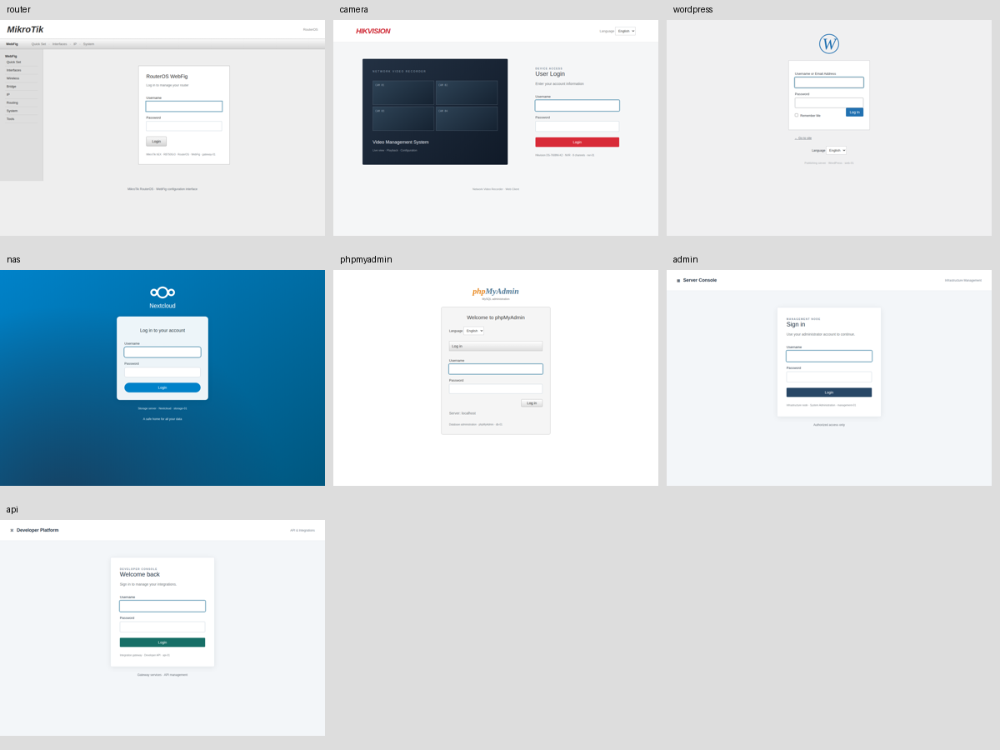

# 🐸 Frog SOC 6.5

[Polski](README.md) · **English**

A lightweight **Linux/Python 3** cyberlab dashboard: VPS monitoring, HTTP traps,
optional **SSH Capture** for login attempts, preserved **Endlessh** history, a shared
timeline, Discord alerts and an XP-earning cyber frog. The dashboard uses Python's
standard library; the optional SSH service requires `py3-paramiko`. No server-side
pip, Node.js or Docker. Install/update scripts target Alpine/OpenRC; the dashboard
itself also runs on other Linux distributions.

Frog observes and alerts. It does not block IPs or replace a firewall or SIEM.

## Public instance

[Open the services portal](http://frog03.mikr.us:31888/) — the project instance’s
public HTTP page, linking to its device profiles. The administration dashboard
remains protected. This address is reachable from the Internet without Cloudflare.

## New in 6.5

The service creates `/var/log/frog-ssh.log` owned by `frogssh` with mode 600 before dropping privileges; `start_pre` checks permissions on each start.

### Optional SSH Capture replacement

`sudo env FROG_ENABLE_SSH_CAPTURE=1 sh update-frog-soc-4.sh` replaces Endlessh
on the **same port** (`endlessh_port`, default 41888), preserving administrative
SSH and Gatus. The updater uses Alpine `py3-paramiko`, creates a separate
`frogssh` user without a login shell, preserves historical Endlessh logs and
backs up the application. Failed verification rolls back the app and SSH service.
A normal update without this variable does not switch an existing Endlessh.

This is an authentication-only custom honeypot using SSH and an OpenSSH-style
banner, not OpenSSH or Cowrie. Every password is rejected; publickey and none
cannot log in. Shell, exec, PTY, SFTP and TCP/X11/agent forwarding are explicitly
rejected. Limits: four concurrent sessions, 30 seconds/session, six attempts per
session; dedicated OS account and host key. These controls do not guarantee the
absence of all library or operating system vulnerabilities.

Password and keyboard-interactive attempts go into a private SQLite spool at
`/var/lib/frog-ssh/attempts.sqlite3` (directory 700, files 600), limited to 1000
rows; maintenance every minute removes rows older than one hour. Frog imports every
`import_interval` into the credentials database under profile `ssh`, deduplicates
retries with persistent acknowledgements, including after dashboard deletion.
The source is read-only to the dashboard; its buffered copy expires within one
hour plus a minute of writing, even when deleted earlier from the dashboard. HTTP retention and dashboard deletion
apply. Credentials remain excluded from telemetry backups. `capture_credentials:
false` disables import; stop `frog-ssh` to stop
capture itself.

Bounded password-free `sessions.log` and `.1` (about 1 MiB each) use the existing
Endlessh import format. Both log sources stay in `endlessh_logs`, preserving old
history. `ssh_capture.enabled` selects the backend; `spool` specifies its private
buffer. Health checks verify listening and readable logs, not protocol negotiation.
Deployment verification negotiates SSH, checks rejection and credential import,
then removes synthetic credentials. Clients see this service's host key; verify
its fingerprint on the server before resolving any host-key warning.

### HTTP authentication and service responses

HTML forms still work. JSON accepts an object or fields nested under `params`,
`User` or `SessionLogin`, with aliases `userName`, `UserName`, `account`,
`Password` and `passWord`. New paths: `/RPC2`, `/ISAPI/Security/sessionLogin`,
`/rest/login`, `/api/auth`. JSON login returns 401 without reflecting passwords.
This is limited emulation without Digest, vendor encryption or RPC execution.

WordPress `/xmlrpc.php` recognizes single `wp.getUsersBlogs`,
`blogger.getUsersBlogs`, `wp.getProfile`, `wp.getUsers`, `wp.getOptions` and
`metaWeblog.getRecentPosts` calls, records credentials and always returns a fault.
It never executes methods. Multicall, DTD/entities and compound parameters are
rejected. The 4096-byte/16-field limits remain: malformed data 400, unsupported
media 415, oversized body 413. XML-RPC GET returns 405.

Selected console paths redirect 302 to login. Public login responses set short-lived
fictional HttpOnly/SameSite=Lax cookies without granting access, and use local CSS
under service-style paths. SOC authentication remains separate. `/` remains the
hub; selecting `honeypots.homepage` does not disable other profiles' paths.

Grouped Docker/phpMyAdmin/configuration and SSH Capture alerts count public IPs
only, excluding localhost, Tailscale and private networks; their events stay in
history. Alerts contain no usernames or passwords. A public IP alone does not
prove maliciousness and may still represent your own public-network tests.

Protocol reference: [Paramiko ServerInterface](https://docs.paramiko.org/en/latest/api/server.html).

### Full capture test and cleanup

From the downloaded repository directory on the server, run:

```bash
sudo python3 tools/verify_ssh_capture.py
```

The script generates a one-time username and random password. It **does not change
any administrator password** or print passwords. It verifies the host key, real
SSH negotiation, authentication denial, exact spool contents, import by the live
worker and visibility in authenticated `/credentials`. It then removes only its
own test username/password from both databases, even if the test fails, and checks
the entry is absent from the page. Spool cleanup runs as its owner, avoiding
root-owned SQLite journals in the service directory. Password-free import
acknowledgements may remain for two hours to prevent an in-flight import from
restoring deleted data. The local session's IP/time remain in SSH history.
No service is stopped and other submissions are preserved. Success ends with
`PASS: live SSH capture and cleanup verified`. Cleanup failures are explicitly
reported and produce a failing exit status. Requires running SSH Capture, enabled
credential collection and sudo. The test connects locally to the configured port.

## New in 6.4



New **phpMyAdmin** profile (`/phpmyadmin`, `/phpmyadmin/index.php`, `/pma`,
`/phpMyAdmin`) captures `pma_username` / `pma_password`. Add `phpmyadmin` to
`honeypots.enabled`. `honeypots.docker_api` (default `true`) enables fictional
API responses at `/_ping`, `/version`, `/info`, `/containers/json`, `/images/json`,
including `/v1.N/` prefixes. Mutation requests return 403; unknown container paths
return 404. No Docker connection, command execution, image downloads or request
body storage. Responses are fixed fixtures unrelated to the real VPS. This is a
limited emulation, not a full Docker protocol implementation.

New configuration lures: `/.env.production`, `/wp-config.php.bak`, `/config.php.bak`,
`/docker-compose.yml`, `/.aws/credentials`. All contents are fixed in-memory data;
none read system files. Passwords and identifiers are not used by real services.

Classification distinguishes Docker API, phpMyAdmin and configuration access.
Built-in grouped alerts count requests and distinct IPs over 15 minutes without
form or request contents, using existing `alerts.enabled`, cooldown and Discord.

Distinct responsive layouts are inspired by WebFig, Hikvision NVR, WordPress,
Nextcloud and phpMyAdmin. All submitted forms still fail authentication. Views use
original HTML/CSS without manufacturer assets or CDNs; they are not exact firmware
replicas and may be recognized as honeypots. All use the existing HTTP port and
install no additional services.

To explicitly enable new traps during an upgrade:
`sudo env FROG_ENABLE_NEW_TRAPS=1 sh update-frog-soc-4.sh`.
Without this variable, the updater preserves the enabled profiles. Configuration
is backed up before changing; existing password, notes and history remain.

Selected response formats: [Docker Engine API](https://docs.docker.com/reference/api/engine/).

## Updates, comparisons and IP notes

Protected `/updates` shows HTTP requests and new IPs and paths since a shared
checkpoint, defaulting to the last 24 hours. “Oznacz jako przeczytane” acknowledges
through the page opening time; refreshing never advances the checkpoint. Lists
are capped at 50 entries; novelty is relative to retained HTTP history.
`/compare?period=24h` (also `7d`, `30d`) compares consecutive rolling periods:
HTTP requests, distinct HTTP IPs, started Endlessh sessions and SSH failures,
with absolute and percentage differences. Incomplete history and retention may
reduce counts. `/ip?ip=ADDRESS` supports a shared label (80 characters) and note
(2000 characters); empty fields remove the entry. IPv4-mapped IPv6 shares its note
with canonical IPv4. Writes and acknowledgement require POST with a signed token
valid for 30 minutes. Notes and checkpoint are in SQLite and automatic telemetry
backups. These features use the existing HTTP port without extra dependencies.

## New in 6.3

The portal shows device type, model, platform and node name. Profiles have
separate styles and simplified forms inspired by these devices/services:

| Profile | Identity | Form action | Username / password fields |
| --- | --- | --- | --- |
| Router | MikroTik hEX RB750Gr3 / RouterOS WebFig | `/webfig/` | `username` / `password` |
| Recorder | Hikvision DS-7608NI-K2 / 8-channel NVR | `/doc/page/login.asp` | `username` / `password` |
| Files | Nextcloud server | `/index.php/login` | `user` / `password` |
| Administration | Management node | `/console/login` | `username` / `password` |
| Website | WordPress | `/wp-login.php` | `log` / `pwd` |
| API | Integration gateway | `/api/login` | `email` / `password` |

Capture also recognizes `user`, `login`, `log`, `email`, `luci_username` and
`pass`, `passwd`, `pwd`, `luci_password`; existing `username`/`password`
clients still work. Profile-specific fields take precedence even when empty.
The first value is stored when a field name is repeated. Additional routes
include `/login.php`, `/cgi-bin/luci`, `/administrator`, `/admin/login`,
`/camera/login.cgi`, `/nextcloud/login` and `/api/auth/login`. Previous
`/router/login`, `/camera/login` and `/storage/login` actions still work.
Disabling a profile also disables its aliases.

This emulates HTTP/forms for a honeypot; it is not firmware or an installation
of those products. It does not implement Digest authentication, vendor login
encryption, WebDAV, video streaming or command execution. Visual similarity
does not guarantee more login attempts. Brand/model names identify fictional
profiles and do not describe actual VPS hardware. No vendor logos, scripts or
other assets are loaded. Dashboard protection, limits, retention and the separate
submissions database remain active.

## New in 6.2

Public responses use a neutral `Server: WebServer` header without the Frog name
or Python version. Access denials and HTTP errors disclose neither the project
name nor the Tailscale requirement. `HEAD` is supported without response bodies.
Demo routes (`/demo`, `/demo/data`) and dashboard assets (`/assets/*`) now require
Tailscale/localhost and dashboard authentication; demo keeps its fictional-data labels.
Previous `/traps/...` URLs return 404; their historical events remain available for analysis.

Public `.env`, Git configuration and JSON contain only fixed, fabricated decoys
without DECOY/placeholder labels. `/backup.zip` is a valid ZIP with two fictional
JSON files, generated in memory without reading VPS files. The included password
is an invented string that is not used by any service. These changes remove explicit
labels; they do not guarantee a honeypot cannot be identified through its behavior,
similarity to the project source or protocol analysis.

## New in 6.1

Public links and form actions use ordinary service routes without the `/traps`
prefix. In 6.1 previous routes remained compatibility aliases; since 6.2 they return 404.

The public portal includes a neutral **SSH Access** card, port number and
`ssh -p PORT HOST` example, using the host of the opened page. It does not disclose Endlessh, honeypot
purpose or SOC dashboard links. Operational details stay in the protected panel.
`honeypots.ssh_public_port` controls the displayed port; `0` (the default) uses
`endlessh_port`. With NAT, set the actual public port here. This does not change
listeners or port mappings. Replace documentation example ports with yours.

## New in 6.0

### More honeypots, linked from the homepage

The public `/` page is a services portal linking to six separate profiles:

| Route | Honeypot |
| --- | --- |
| `/router` | Router management |
| `/camera` | IP camera console |
| `/storage` | Network storage / NAS |
| `/console` | Administration console |
| `/wp-admin` | Website publishing console |
| `/api` | API integration console |

Forms submit to `/webfig/`, `/doc/page/login.asp`, `/index.php/login`,
`/console/login`, `/wp-login.php` and `/api/login`. These pages do not provide
real authentication, files, streams or command execution. Captured submissions
now include their originating profile; older submissions are marked as router.
Additional decoys `/.env`, `/.git/config`, `/backup.zip` and `/config.json`
return prepared fictional content, never actual VPS files. Since 6.2 `/backup.zip`
is a valid ZIP archive containing fictional JSON files.

All profiles share **one Frog HTTP port**. No six additional public ports are
needed; Endlessh keeps its own separate TCP port. Example configuration:

```json
{
  "honeypots": {
    "enabled": ["router", "camera", "nas", "admin", "wordpress", "api"],
    "homepage": "hub"
  },
  "health_checks": {
    "gatus_url": "http://127.0.0.1:21888/health",
    "timeout_seconds": 2,
    "interval_seconds": 30,
    "endlessh_stale_seconds": 120
  },
  "demo_enabled": true
}
```

`homepage` can be `hub` or the name of an enabled profile. **21888 is another
example port from the author's VPS**; use your own Gatus endpoint or an empty
string to skip its HTTP check. Disabling a profile removes its link and route.
Legacy `/admin`, `/login`, `/cgi-bin/luci` still map to router; `/wp-login.php`,
`/camera`, `/nas` and `/api/login` have corresponding aliases.

### Bot profiles and scan classification

`/ip?ip=ADDRESS` combines HTTP, Endlessh, failed authentication and submission
activity without displaying submitted credential contents. It shows up to 200
recent events, User-Agent values, profiles and gaps between HTTP requests.
A gap over 30 minutes splits visits in the available slice. One IP may represent
multiple devices. User-Agent is client-supplied and spoofable; it is collected
from this version onward, limited to 300 characters. Cookies and Authorization
headers are not collected.

Labels recognize WordPress, configuration, Git, backup, router/CGI, camera,
NAS and API paths. Each includes a reason and matching example paths.
A label match alone does not establish malicious activity.

### Dashboard-managed observation rules

`/rules` supports creating, editing, disabling and deleting up to 25 rules,
without Python edits or restarts. Rules live in SQLite and are included in
telemetry backups, rather than being written to `config.json`. Changes require
POST and a signed token.

- `path`: request count per IP for an exact path or prefix ending in `*`.
- `panels`: count of distinct honeypot profiles visited by one IP.

Examples: one `/backup.zip` request in 60 seconds; 5 different profiles within
60 seconds. Windows range from 1–86400 seconds. Notifications use the existing
alert worker and a per-rule cooldown, include up to 5 example IPs and never
contain passwords. Rules do not execute regexes, code or shell commands.

### Real service checks

`/healthchecks` checks every 30 seconds: Frog's `/health`, HTTP from Gatus,
Tailscale BackendState/address/online status, and the Endlessh listener plus
freshness of successful log reads. A successful read is checked even without
new connections; an old log modification time alone does not indicate failure.
No test Endlessh connections are opened. These results replace process-only
checks in the dashboard and required-service alerts.

The checks have defined limits: Gatus HTTP 200 does not establish the health
of all its monitored endpoints; Tailscale status is not a ping to every peer.

### World map and demonstration mode


`/geo` uses offline outlines for 177 countries from Natural Earth, a date filter,
5° point clusters, an hourly slider and day playback. Data refreshes every
30 seconds without resetting the slider. Hours use the server timezone;
repeated daylight-saving hours are grouped together. Limit: 5,000 IP/hour groups.
Only HTTP events with an existing geolocation entry are shown. Outlines need
no external tiles or CDN; IP geolocation still uses `ipwho.is` as configured.
Map source and terms are documented in `THIRD_PARTY.md`.

Protected `/demo` and `/demo/data` use only fictional data and documentation IPs.
They never read production databases, log visits/submissions or expose admin
operations. They require Tailscale/localhost and dashboard authentication,
as do map assets and scripts. Disable with `demo_enabled: false`.
The demo is not linked from the public services portal.

## New in 5.2

- **Login attempt statistics** (`/credential-stats`): attempt and distinct-IP
  counts, top 20 usernames, passwords and combinations, plus distinct IPs per
  combination. These protected statistics use retained submissions only.
- **Similar bot patterns** (`/campaigns`): matching username/password pairs
  across different IPs and similar HTTP path families. Default window: 24 hours,
  at least 2 IPs and 3 attempts. Path families cover WordPress, CGI/router,
  login panels and paths with numeric identifiers. Similarity is a heuristic,
  not proof of common attribution. Up to 20 groups and 20 IPs per group are shown.
- **Daily Discord report** (`/reports`): defaults to **20:00 in the server timezone**,
  covering the previous complete calendar day. It includes HTTP, Endlessh and
  failed-SSH counts, the longest session started that day, newly observed IPs
  within retained history, submission count and currently active alert count.
  Submitted usernames and passwords are never included. Requires `.discord-webhook`.
- **Submission deletion** (`/credentials`): delete selected records or the entire
  history as it existed when the form was opened, across all pages. Type `USUN`
  and select the appropriate button. Deletion requires authentication and a
  signed token valid for 30 minutes; GET never deletes data. Submissions captured
  after the form was opened remain untouched. Deletion cannot be undone.
  Reopen the form after a service restart.

New settings can be added to an existing `config.json`:

```json
{
  "daily_report": {"enabled": true, "hour": 20, "minute": 0},
  "campaigns": {"window_hours": 24, "min_ips": 2, "min_attempts": 3}
}
```

The report scheduler checks every minute. The last successfully reported day
is persisted in SQLite, so a restart does not resend it. Failed delivery is
retried; a timeout after Discord accepts a message can cause a duplicate.
After downtime, only the latest complete day is reported, without replaying
the entire backlog. `/reports` provides a preview and delivery status.
Statistics and pattern detection respect data retention; deleted submissions
also disappear from those summaries.

## New in 5.1: router honeypot form capture

The fake router login now records the username and password submitted as an
`application/x-www-form-urlencoded` form (`username`, `password`) to `/login`
or another recognized honeypot path. Actual Frog administrator authentication
is never collected by this feature.

- View submissions at **`/credentials`**, through the protected dashboard.
- Storage: `/opt/frog-soc/honeypot-credentials.sqlite3`, file mode `600`.
- Passwords are stored **in plaintext**. Expand “Pokaż hasło” to view a password.
  Collapsing the field only hides it visually; it does not encrypt the data.
- This database is separate and is **not included** in automatic telemetry
  backups or deployment backups.
- Default retention: **7 days / 10,000 submissions**, enforced on insertion
  and during maintenance.
- Maximum request body: 4 KiB / 16 fields; usernames are limited to 256
  characters and passwords to 512 characters.
- Submissions are not sent to Discord, HTTP event logs or the Endlessh CSV export.
- Set `capture_credentials: false` in `config.json` to stop collection.
  Existing records remain until retention removes them. Configure
  `retention.credentials_days` and `retention.credentials_rows` to change limits.

## Features introduced in 5.0

- A single `config.json` for ports, logs, trusted networks, alert thresholds,
  retention, refresh/import intervals and backups.
- Endlessh history filters for IP, dates, status and minimum duration;
  newest/longest sorting and CSV export using the same filters.
- Per-IP details: HTTP/SSH event and session counts, first/last session,
  total time and longest connection. IPv4-mapped IPv6 addresses are supported.
- A shared timeline of HTTP requests, Endlessh sessions and failed sshd/Dropbear logins.
- Returning-IP rankings and hourly HTTP/Endlessh activity charts.
- Stable alert identifiers and state persisted in SQLite. Changing a counter
  does not bypass the cooldown, and restarting does not reset notification times.
- Recovery notices, HTTP traffic surge detection and longest-session notices.
- Daily consistent SQLite backups and automatic data retention.
- Persistent frog XP: 10 per HTTP event and 5 per Endlessh session.
  Expiring history does not reduce the frog's level.
- Background refresh without full-page reloads; edited forms are preserved.
- Responsive layout and dashboard status for the importer, backups and maintenance.
- A fresh installer and an updater with backups and authenticated HTTP checks.

## Architecture and ports

**31888 and 41888 are examples from the author's VPS, not required port numbers.**
Choose ports available on your hosting account, and configure the services,
firewall and any NAT mappings accordingly.

| Service | Role | Example local port |
| --- | --- | --- |
| Frog SOC | HTTP honeypot and protected web dashboard | 31888/TCP |
| Endlessh | Separate SSH tarpit | 41888/TCP |
| Real SSH | VPS administration | A separate port chosen by you or the hosting provider |

Frog and Endlessh must use **different ports**. Allow the relevant two TCP ports
in your firewall and hosting panel. If your hosting uses NAT, configure:

```text
YOUR_PUBLIC_HTTP_PORT → VPS:FROG_PORT_FROM_CONFIG
YOUR_PUBLIC_SSH_TARPIT_PORT → VPS:ENDLESSH_PORT
```

Public and local ports may be identical or different. Application settings do
not create firewall rules or port mappings.

Frog runs an HTTP server. Endlessh runs separately and slowly sends an SSH
banner before authentication, tying up clients. It is not a login server and
does not collect SSH passwords. Keep your real administration SSH separate.

Without Endlessh, system monitoring and the HTTP honeypot still work.
SSH connection history requires a working Endlessh instance **with logging enabled**.

## Requirements

- Linux with `/proc`; Alpine Linux with OpenRC for the supplied automatic scripts.
- Python 3 including `sqlite3` (tested with Python 3.12 and 3.14).
- `/proc` access for memory, process and TCP monitoring.
- Root/sudo for installation, reading protected logs and restarting services.
- Endlessh for the SSH tarpit and connection logs.
- Tailscale for private remote dashboard access, or an SSH tunnel to localhost.
- Logrotate and a running cron service for log rotation. The installer/updater
  installs logrotate.

Gatus is optional and is only observed. Discord notifications are optional.
Geolocation requires HTTPS access to `ipwho.is`; notifications need Discord access.
The installer does not authenticate Tailscale or change network rules.

## One configuration file

Example: [`deploy/config.example.json`](deploy/config.example.json).
On the server: **`/opt/frog-soc/config.json`**.

The updater creates this file if absent and preserves existing settings on
subsequent deployments. Partial configurations are supported: missing options
use defaults. Unknown keys, wrong types, invalid ports and invalid networks
are rejected.

Example partial configuration:

```json
{
  "capture_credentials": true,
  "listen_host": "0.0.0.0",
  "http_port": 31888,
  "endlessh_port": 41888,
  "endlessh_logs": ["/var/log/endlessh.log*"],
  "trusted_networks": ["100.64.0.0/10"],
  "alerts": {
    "cooldown_seconds": 900,
    "http_hour": 100,
    "ip_hour": 50,
    "endlessh_record_seconds": 300
  },
  "retention": {
    "http_days": 90,
    "endlessh_days": 90,
    "endlessh_rows": 100000,
    "credentials_days": 7,
    "credentials_rows": 10000
  }
}
```

Replace example ports with yours. Restart after changing configuration:

```sh
sudo rc-service frog-soc restart
```

`endlessh_port` is the port Frog monitors. For a pre-existing Endlessh service,
set the same port in its `-p` argument and restart that service separately.
The fresh installer's `frog-endlessh` service reads its port from `config.json`
at startup; restart it too when changing ports. Restarting Endlessh disconnects
current sessions.

The dashboard password and Discord webhook remain separate secrets:
`.soc-password` and `.discord-webhook`, with mode `600`. Never commit them.
`/settings` displays non-secret configuration and maintenance status.

## Fresh installation

Clone the repository on Alpine, copy the example configuration and edit your ports:

```sh
cp deploy/config.example.json /tmp/frog-config.json
vi /tmp/frog-config.json
sudo sh install.sh /tmp/frog-config.json
```

The installer:

1. Installs Python, Endlessh and logrotate from Alpine repositories.
2. Validates configuration and asks for a new dashboard password, at least 12 characters.
3. Creates the application, data files and `frog-soc` OpenRC service.
4. If Endlessh is not already running, creates `frog-endlessh`, with `-v`
   logging to `/var/log/endlessh.log` and its port read from `config.json`.
5. Enables services at boot and installs the log rotation recipe.

The Endlessh package must be available in your configured Alpine repositories,
usually community. The installer refuses to replace an existing Frog installation.
If Endlessh is already running, it preserves that service; match its port and
log path in Frog's configuration. The default required-service list includes
Tailscale; remove it from `required_services` if you only use an SSH tunnel.

The fresh installer has shell syntax validation. The live VPS uses the existing-installation
updater described below.

## Other Linux distributions: running with systemd

The application itself needs Python 3 with `sqlite3`, `/proc`, access to logs
and a writable data directory. It does not depend on `apk` or OpenRC.
**`install.sh`, `deploy/deploy.sh` and the standalone updater still target
Alpine/OpenRC.** The following is a fresh manual installation example for
systemd; preserve existing configuration and passwords when updating.

Install Python 3 and separately Endlessh using your distribution's packages, then:

```sh
sudo mkdir -p /opt/frog-soc
sudo cp deploy/app.py deploy/features.js deploy/world.svg /opt/frog-soc/
sudo install -m 600 deploy/config.example.json /opt/frog-soc/config.json
sudoedit /opt/frog-soc/config.json
sudo python3 - <<'PYTHON'
import getpass, pathlib
first = getpass.getpass('Dashboard password (at least 12 characters): ')
second = getpass.getpass('Repeat password: ')
if len(first) < 12 or first != second:
    raise SystemExit('Passwords differ or are too short')
p = pathlib.Path('/opt/frog-soc/.soc-password')
p.touch(mode=0o600)
p.write_text(first + '\n')
p.chmod(0o600)
PYTHON
sudo cp deploy/frog-soc.service /etc/systemd/system/
sudo systemctl daemon-reload
sudo systemctl enable --now frog-soc
```

The template runs as root to access protected logs and `/proc`. Check with
`systemctl status frog-soc`; read logs with `journalctl -u frog-soc`.
Configure Endlessh, Tailscale, ports, firewall and the Endlessh log file separately.
Manual updates require backups of application/configuration and SQLite, plus
`systemctl restart frog-soc`. The unit is a template and was not installed
on the author's VPS, which runs Alpine/OpenRC.

## Updating an existing installation

Requires `/opt/frog-soc/app.py`, `.soc-password` and the `frog-soc` service.

```sh
scp -r deploy USER@VPS:~/frog-update-v6
ssh USER@VPS
sudo sh ~/frog-update-v6/deploy.sh
```

For a nonstandard administration port, use `scp -P PORT` and `ssh -p PORT`,
or your SSH alias. Use a new destination directory if one already exists,
so `scp -r` does not add an extra nested `deploy/` directory.

The updater preserves the password and configuration, backs up the application
and telemetry SQLite database under `/opt/frog-soc/backups/v6-DATE-TIME/`,
replaces the application and restarts Frog. It checks authenticated views,
CSV, JavaScript and invalid-filter handling. On restart/HTTP failure it restores
the previous application and any pre-existing configuration. The database copy
remains for manual restoration; new tables are not removed automatically.
Endlessh is not restarted. The separate submission database is not backed up.

A standalone generated updater is also available:

```sh
sudo sh update-frog-soc-4.sh
```

The filename is retained for compatibility; it installs **6.3** using the same
backup and validation procedure as `deploy/deploy.sh`.

## Access and dashboard routes

The dashboard shares Frog's port with the HTTP honeypot. Administrative routes
require localhost or a source address in `trusted_networks`, followed by HTTP
Basic Auth: username **`frog`**, password from `.soc-password`.

```text
http://TAILSCALE_ADDRESS:YOUR_FROG_PORT/soc
http://TAILSCALE_ADDRESS:YOUR_FROG_PORT/ssh
```

An SSH tunnel can be used instead of Tailscale:

```sh
ssh -L 8080:127.0.0.1:YOUR_FROG_PORT USER@VPS
```

Then open `http://127.0.0.1:8080/soc`.

| Route | Contents |
| --- | --- |
| `/soc` | VPS/service monitoring and HTTP/Endlessh chart |
| `/ssh` | Filtered session history and returning-IP ranking |
| `/ssh.csv` | CSV using the history filters |
| `/ip?ip=ADDRESS` | Per-IP summary |
| `/activity` | Latest 200 HTTP/Endlessh/SSH events; optional `ip` filter |
| `/credential-stats` | Username, password and combination statistics |
| `/campaigns` | Similar attempt patterns across different IPs |
| `/reports` | Daily Discord report preview and status |
| `/credentials` | Usernames/passwords submitted to the fake router form |
| `/rules` | Dashboard-managed observation rules |
| `/healthchecks` | Real service checks |
| `/demo` | Protected demonstration using fictional data |
| `/settings` | Configuration, importer, backup and maintenance status |
| `/stats` | Recent HTTP and buffer rankings; hourly count from SQLite |
| `/history` | 48-hour HTTP history |
| `/investigate` | Alerts, processes and SSH log samples |
| `/geo` | Approximate coordinates of public HTTP client IPs |
| `/frog` | Persistent XP, level and badges |
| `/soc/json` | Monitoring JSON |
| `/health` | Public `ok` response |

`/ssh` and `/ssh.csv` filters: `ip`, `from`, `to` (inclusive dates in YYYY-MM-DD),
`status` (`closed`/`pending`), `min_seconds`, `sort` (`newest`/`longest`).
Dates filter session start times and use the server timezone. Page number: `page`.

The application does not provide HTTPS. Use Tailscale or an SSH tunnel.
A localhost reverse proxy changes the source address seen by Frog, which does
not trust `X-Forwarded-For`. Do not expose the dashboard through such a proxy
without additional access control.

## Endlessh logging

Example arguments for an existing service:

```text
-p YOUR_ENDLESSH_PORT -d 10000 -m 256 -v
```

`-v` enables the ACCEPT/CLOSE logs needed for history. For stdout logging, set
these in your OpenRC service:

```sh
output_log="/var/log/endlessh.log"
error_log="/var/log/endlessh.log"
```

Alternatively use `-v -s` for syslog and configure the appropriate file in
`endlessh_logs`. Do not import both stdout and syslog for the same instance:
timestamp precision differences can produce duplicates. Logs must come from
the intended single Endlessh instance. The `port` field is the **client source
port**, not the listening port.

Frog persists read offsets in SQLite and imports every 5 seconds by default.
It supports IPv4/IPv6, uncompressed log rotation and detected truncation.
Files ending in `.gz`, `.xz` or `.bz2` are skipped. Missing CLOSE means an
open connection or incomplete logs; a separate active TCP count comes from
the kernel. Duration is read from CLOSE; when ACCEPT is absent, start time is
calculated from end time and duration. Earlier sessions cannot be recovered
without retained logs. Yearless syslog timestamps use the file modification date.

## Alerts, storage and maintenance

Default thresholds: RAM/disk 85%, HTTP 100/hour, individual IP 50/hour,
failed SSH logins 10/hour, HTTP surge at least 3× the previous hour and at
least 100/hour, new longest Endlessh session from 300 seconds.
`required_services` controls monitored required services; Gatus is optional.

Alerts run every 60 seconds. Cooldown is 15 minutes for a stable alert type/IP,
independent of changing counts. State survives restarts. Failed delivery does
not consume the cooldown. Recovery messages are controlled by `alerts.recovery`;
a session record is a one-time observation. Service checks detect processes/ports,
not full tunnel or application health. Authentication logs are sampled from
each file's last 256 KiB per alert cycle; high traffic or rapid rotation can
cause events to be missed.

| Data | Default retention |
| --- | --- |
| HTTP SQLite events | 90 days / 30,000 rows |
| Endlessh SQLite sessions | 90 days / 100,000 rows |
| sshd/Dropbear events | 30 days |
| Router form submissions, separate database | 7 days / 10,000 rows |
| Automatic telemetry backups | Every 24 hours; keep latest 7 files |

In-app maintenance runs hourly. Consistent telemetry backups use SQLite's
backup API and are stored in `/opt/frog-soc/backups/automatic/` with mode `600`.
Deployment backups are separate and are not automatically removed. Retention
deletes rows but does not guarantee immediate SQLite file shrinkage. Monitor
free space and periodically archive backups off the VPS.

The logrotate recipe keeps 5 uncompressed rotations with a 5 MiB threshold.
It requires cron and uses `copytruncate` to avoid restarting the tarpit; a small
window of log loss is possible while copying/truncating. Size is checked when
logrotate runs, not after every write.

XP is initialized from retained history during migration, then tracked
persistently. Previously deleted history cannot be recovered. Geolocation sends
public HTTP client IPs to `ipwho.is`, up to 12 attempts/hour. It is approximate
and does not prove a person's location. Disable it with `geo_enabled: false`.

## Development and tests

**`deploy/app.py` is the canonical application source.** Regenerate the standalone
updater after changing deployment sources:

```sh
python3 tools/build_update.py
python3 tools/build_update.py --check
sh -n install.sh
sh -n deploy/deploy.sh
sh -n update-frog-soc-4.sh
python3 -m unittest discover -s tests -v
```

57 tests cover log import/rotation, IPv6, filters/CSV, configuration validation,
persistent alerts/XP, SQLite backups, authenticated HTTP routes, submission
capture, access control, retention, new honeypots, database-isolated demo,
map data, HTTP headers/errors, HEAD, private assets, valid ZIP archives, bot profiles, observation rules, service checks, statistics, pattern grouping, report scheduling
and confirmed deletion with CSRF tokens. HTTP tests require local TCP sockets.

Keep **both README languages updated together**, as required by `AGENTS.md`.
Never commit passwords, webhook URLs, SSH keys, databases or logs. `.gitignore`
excludes common data and secret files.

Upstream documentation: [Endlessh](https://github.com/skeeto/endlessh).
