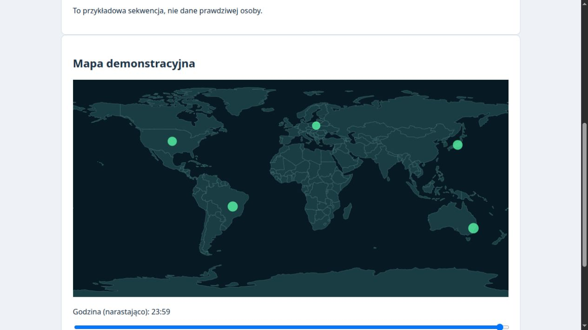

# 🐸 Frog SOC 6.2

**Polski** · [English](README.en.md)

Lekki panel cyberlaboratorium dla **Linuxa z Pythonem 3**: monitoring VPS,
pułapka HTTP, historia osobnego honeypota SSH **Endlessh**, wspólna oś zdarzeń,
alerty Discord i cyberżaba zdobywająca XP. Python i biblioteka standardowa;
bez pip, Node.js i Dockera. Gotowe skrypty instalacji i aktualizacji są obecnie
dla Alpine/OpenRC; aplikację można uruchomić również na innych dystrybucjach Linux.

Frog obserwuje i alarmuje. Nie blokuje IP, nie zastępuje firewalla ani SIEM.

## Co nowego w 6.2

Publiczne odpowiedzi mają neutralny nagłówek `Server: WebServer`, bez nazwy
Frog i wersji Pythona. Odmowy dostępu oraz błędy HTTP nie ujawniają nazwy
projektu ani wymogu Tailscale. Obsługiwane jest również `HEAD` bez treści.
Demo (`/demo`, `/demo/data`) i zasoby panelu (`/assets/*`) wymagają teraz
Tailscale/localhost oraz hasła panelu; demo zachowuje oznaczenia fikcyjnych danych.
Dawne adresy `/traps/...` zwracają 404; ich historyczne zdarzenia nadal są analizowane.

Publiczne `.env`, konfiguracja Git i JSON zawierają wyłącznie stałe, wygenerowane
przynęty bez napisów DECOY/placeholder. `/backup.zip` to prawidłowy ZIP z dwoma
fikcyjnymi plikami JSON, tworzony w pamięci, bez odczytu plików VPS.
Wpisane tam hasło jest wymyślonym ciągiem i nie jest używane przez żadną usługę.
Ta zmiana usuwa jawne oznaczenia; nie gwarantuje nierozpoznawalności honeypota
na podstawie zachowania, podobieństwa do kodu projektu lub analizy protokołu.

## Co nowego w 6.1

Publiczne linki i formularze korzystają ze zwykłych adresów usług, bez prefiksu
`/traps`. W wersji 6.1 stare adresy pozostawały aliasami; od 6.2 zwracają 404.

Publiczny portal zawiera neutralną kartę **SSH Access**, numer portu i przykład
`ssh -p PORT ADRES` (adres pochodzi z hosta otwartej strony). Nie ujawnia nazwy Endlessh, przeznaczenia
pułapki ani linków do panelu SOC. Oznaczenia i historia są w chronionym panelu.
`honeypots.ssh_public_port` ustawia port pokazywany publicznie; wartość `0`
(domyślna) używa `endlessh_port`. Przy NAT wpisz tu faktyczny port publiczny.
Nie przestawia to nasłuchu ani przekierowań. Przykładowe porty z dokumentacji
należy dopasować do swojego hostingu.

## Co nowego w 6.0

### Więcej pułapek, odkrywanych ze strony głównej

Publiczna strona `/` to portal z linkami do sześciu niezależnych profili:

| Ścieżka | Pułapka |
| --- | --- |
| `/router` | Zarządzanie routerem |
| `/camera` | Konsola kamery IP |
| `/storage` | Pamięć sieciowa / NAS |
| `/console` | Panel administracyjny |
| `/wp-admin` | Panel publikowania strony |
| `/api` | Konsola integracji API |

Formularze wysyłają dane pod `/router/login`, `/camera/login`, `/storage/login`,
`/console/login`, `/wp-login.php` i `/api/login`. Nie udostępniają
prawdziwego logowania, plików, streamingu ani wykonywania poleceń. Zapisane
formularze mają teraz oznaczenie pułapki. Stare wpisy są oznaczane jako router.
Dodatkowe przynęty `/.env`, `/.git/config`, `/backup.zip`, `/config.json`
zwracają wyłącznie przygotowane, fikcyjne dane — nigdy pliki VPS.
Od 6.2 `/backup.zip` jest prawidłowym archiwum ZIP z fikcyjnymi plikami JSON.

Wszystko działa na **jednym porcie HTTP Frog**. Nie trzeba wystawiać sześciu
nowych portów; Endlessh nadal korzysta ze swojego osobnego portu TCP.
Przykładowa konfiguracja:

```json
{
  "honeypots": {
    "enabled": ["router", "camera", "nas", "admin", "wordpress", "api"],
    "homepage": "hub"
  },
  "health_checks": {
    "gatus_url": "http://127.0.0.1:21888/health",
    "timeout_seconds": 2,
    "interval_seconds": 30,
    "endlessh_stale_seconds": 120
  },
  "demo_enabled": true
}
```

`homepage` może być `hub` albo nazwą włączonego profilu. Port Gatus **21888
jest również przykładem z VPS autora** — wpisz własny endpoint lub pusty ciąg,
aby pominąć test HTTP Gatus. Wyłączenie profilu usuwa jego link i trasę.
Legacy `/admin`, `/login`, `/cgi-bin/luci` nadal kierują do routera, a
`/wp-login.php`, `/camera`, `/nas`, `/api/login` mają odpowiednie aliasy.

### Profile botów i rozpoznawanie skanowania

`/ip?ip=ADRES` łączy HTTP, Endlessh, nieudane logowania i informację o wysłanych
formularzach bez pokazywania ich treści. Pokazuje do 200 ostatnich zdarzeń,
User-Agent, pułapkę i odstępy między żądaniami HTTP. Przerwa ponad 30 minut
rozdziela wizyty w dostępnym wycinku. Jeden IP może reprezentować wiele urządzeń.
User-Agent jest deklaracją klienta i może być podrobiony; zbierany jest od tej
wersji, maks. 300 znaków, bez cookies i nagłówka Authorization.

Etykiety rozpoznają ścieżki WordPressa, konfiguracji, Git, kopii zapasowych,
routera/CGI, kamery, NAS i API. Każda pokazuje przyczynę i przykładowe ścieżki.
Samo dopasowanie etykiety nie jest dowodem ataku.

### Reguły z panelu

`/rules` pozwala dodawać, edytować, wyłączać i usuwać do 25 reguł bez edycji
Pythona i restartu. Reguły są w SQLite, objęte backupem telemetrii; nie są
kopiowane do `config.json`. Zmiany wymagają POST i podpisanego tokenu.

- `path`: liczba żądań jednego IP dla dokładnej ścieżki lub prefiksu z końcowym `*`.
- `panels`: liczba różnych profili pułapek odwiedzonych przez jeden IP.

Przykłady: `/backup.zip` co najmniej raz w 60 s; 5 różnych paneli w 60 s.
Okno może wynosić 1–86400 s. Powiadomienia korzystają z istniejącego worker'a
alertów i wyciszenia per reguła; zawierają do 5 przykładowych IP, bez haseł.
Formularze reguł nie wykonują regexów, kodu ani poleceń systemowych.

### Rzeczywiste testy usług

`/healthchecks` pokazuje co 30 s: odpowiedź `/health` Frog, HTTP Gatus,
BackendState/adres/online Tailscale oraz nasłuch i świeżość poprawnego odczytu
logów Endlessh. Odczyt logu jest sprawdzany nawet przy braku nowych połączeń;
stary czas modyfikacji pustego logu sam w sobie nie oznacza awarii.
Nie otwieramy testowych sesji Endlessh. Wyniki zastępują proste wykrywanie
procesów w centrum i w alertach wymaganych usług.

To testy konkretnego zakresu: HTTP 200 Gatus nie potwierdza sprawności wszystkich
jego endpointów, a status Tailscale nie jest pingiem do każdego peera.

### Mapa świata i demonstracja



`/geo` ma lokalne kontury 177 państw z Natural Earth, wybór dnia, grupowanie
punktów w komórkach 5°, suwak godzin i odtwarzanie dnia. Dane odświeżają się
w tle co 30 s, bez zerowania suwaka. Godziny dotyczą strefy serwera;
powtórzona godzina zmiany czasu jest grupowana razem. Limit: 5000 grup IP/godzina.
Widoczne są tylko zdarzenia HTTP, których IP ma już wpis geolokalizacji.
Kontury nie wymagają kafelków ani CDN; geolokalizacja nadal używa `ipwho.is`
zgodnie z konfiguracją. Źródło i warunki mapy: `THIRD_PARTY.md`.

Chronione `/demo` i `/demo/data` korzystają wyłącznie z fikcyjnych danych oraz
adresów dokumentacyjnych. Nie czytają bazy produkcyjnej, nie zapisują odwiedzin
ani formularzy i nie udostępniają operacji administracyjnych. Dostęp wymaga
Tailscale/localhost i hasła panelu, podobnie jak zasoby mapy i skrypty.
Wyłączenie: `demo_enabled: false`. Demo nie jest linkowane z publicznego portalu.

## Co nowego w 5.2

- **Statystyki prób logowania** (`/credential-stats`): liczba prób i różnych IP,
  top 20 loginów, haseł i kombinacji, liczba adresów dla każdej kombinacji.
  Dane pochodzą wyłącznie z zachowanych formularzy; widok wymaga autoryzacji.
- **Podobne wzorce botów** (`/campaigns`): grupy tych samych kombinacji
  login/hasło z różnych IP oraz podobnych ścieżek HTTP. Domyślne okno: 24 h,
  minimum 2 IP i 3 próby. Rodziny ścieżek obejmują WordPress, CGI/router,
  panele logowania i ścieżki z numerycznymi identyfikatorami.
  To heurystyka podobieństwa, a nie dowód wspólnego sprawcy. Widok pokazuje
  maksymalnie 20 grup i 20 adresów w każdej grupie.
- **Dzienny raport Discord** (`/reports`): domyślnie o **20:00 w strefie serwera**,
  za poprzedni zakończony dzień kalendarzowy. Zawiera liczby HTTP, sesji
  Endlessh i błędów SSH, najdłuższą sesję rozpoczętą danego dnia, liczbę
  nowych IP w zachowanej historii, liczbę formularzy oraz aktualnie aktywnych
  alertów. Nie zawiera loginów ani haseł. Wymaga `.discord-webhook`.
- **Usuwanie formularzy** (`/credentials`): zaznaczone wpisy albo cała historia
  z chwili otwarcia formularza, na wszystkich stronach. Wpisz `USUN` i wybierz
  odpowiedni przycisk. Żądanie wymaga autoryzacji i podpisanego tokenu ważnego
  30 minut; GET nie usuwa danych. Nowe wpisy po otwarciu formularza pozostają.
  Usunięcia nie można cofnąć. Po restarcie ponownie otwórz formularz.

Nowe opcje konfiguracji (można dodać do istniejącego `config.json`):

```json
{
  "daily_report": {"enabled": true, "hour": 20, "minute": 0},
  "campaigns": {"window_hours": 24, "min_ips": 2, "min_attempts": 3}
}
```

Raport sprawdzany jest co minutę. Dzień ostatniego udanego wysłania zapisuje
się w SQLite, więc restart nie wysyła go ponownie. Błąd dostarczenia powoduje
ponowienie; timeout po przyjęciu wiadomości przez Discord może spowodować duplikat.
Po przestoju wysyłany jest tylko ostatni zakończony dzień, bez nadrabiania
całej zaległości. `/reports` udostępnia podgląd i stan ostatniej wysyłki.
Statystyki i wykrywanie wzorców uwzględniają retencję; usunięte formularze
znikają też z tych podsumowań.

## Co nowego w 5.1

Fałszywy panel routera zapisuje login i hasło z wysłanego formularza
`application/x-www-form-urlencoded` (`username`, `password`) pod `/login`
lub pozostałymi znanymi ścieżkami pułapki. Nie dotyczy to logowania
administracyjnego do Frog SOC.

- Podgląd: **`/credentials`**, zakładka „Formularze pułapki”.
- Dane: `/opt/frog-soc/honeypot-credentials.sqlite3`, uprawnienia `600`.
- Hasła są zapisane jawnym tekstem; tylko chroniony panel umożliwia podgląd.
  Rozwijane pole „Pokaż hasło” ukrywa je wizualnie, nie szyfruje danych.
- Baza formularzy jest osobna i **nie jest kopiowana** przez automatyczne
  backupy telemetrii ani backupy wdrożenia.
- Domyślnie 7 dni / 10 000 wpisów; limit sprawdzany przy zapisie i utrzymaniu.
- Maksymalny formularz: 4 KiB / 16 pól; login do 256 znaków, hasło do 512.
- Dane nie są przesyłane do Discorda, CSV historii Endlessh ani logów HTTP.
- W `config.json`: `capture_credentials: false` wyłącza dalsze zbieranie;
  dotychczasowe wpisy pozostają do końca retencji. Parametry retencji:
  `retention.credentials_days` i `retention.credentials_rows`.

## Funkcje 5.0

- Jeden `config.json`: porty, logi, zaufane sieci, progi alertów, retencja,
  częstotliwości odczytu i odświeżania, backupy.
- Historia Endlessh: filtry IP, daty, statusu i minimalnej długości;
  sortowanie od najnowszych lub najdłuższych; eksport CSV z tymi samymi filtrami.
- Widok IP: liczba sesji i zdarzeń HTTP/SSH, pierwsza i ostatnia sesja,
  łączny czas oraz najdłuższe połączenie. Obsługa IPv4 mapowanych w IPv6.
- Wspólna oś HTTP, Endlessh i nieudanych logowań sshd/Dropbear.
- Ranking powracających IP i wykres godzinowej aktywności HTTP/Endlessh.
- Alerty ze stałymi identyfikatorami i stanem zapisanym w SQLite.
  Zmiana licznika nie omija wyciszenia, restart nie zeruje czasu wysyłki.
  Powiadomienia o powrocie do normy, wzroście ruchu i rekordzie długości sesji.
- Codzienne spójne backupy SQLite i automatyczna retencja danych.
- Trwałe liczniki XP: 10 za zdarzenie HTTP, 5 za sesję Endlessh.
  Usuwanie historii nie obniża poziomu żaby.
- Odświeżanie zawartości w tle, bez przeładowania całej strony;
  formularz zmieniany przez użytkownika nie jest nadpisywany.
- Układ dostosowany do telefonu, stan importera i backupów w panelu.
- Instalator od zera oraz aktualizator z backupem i sprawdzeniem HTTP.

## Architektura i porty

**31888 i 41888 są przykładami z VPS autora. Nie są wymaganymi numerami
portów.** Wybierz porty przydzielone przez Twój hosting i wpisz własne wartości
w konfiguracji, usługach oraz regułach firewall / mapowaniach NAT.

| Usługa | Rola | Przykładowy port lokalny |
| --- | --- | --- |
| Frog SOC | Honeypot HTTP + chroniony panel WWW | 31888/TCP |
| Endlessh | Osobna pułapka na klientów SSH | 41888/TCP |
| Prawdziwe SSH | Administracja VPS | Osobny port ustalony przez Ciebie / hosting |

Frog i Endlessh muszą używać **różnych portów**. Udostępnij dwa odpowiednie
porty TCP w firewallu i panelu hostingu. Przy NAT ustaw:

```text
TWÓJ_PUBLICZNY_PORT_HTTP → VPS:PORT_FROG_Z_CONFIG
TWÓJ_PUBLICZNY_PORT_PUŁAPKI_SSH → VPS:PORT_ENDLESSH
```

Port publiczny może być taki sam jak lokalny albo inny — zależy od hostingu.
Konfiguracja aplikacji nie tworzy mapowań i reguł sieciowych.

Frog uruchamia własny serwer HTTP; Endlessh jest osobnym procesem.
Endlessh bardzo powoli wysyła baner SSH przed uwierzytelnieniem, zatrzymując
klientów. Nie jest serwerem logowania i nie zbiera haseł. Nie zastępuj nim
prawdziwego SSH, którym administrujesz VPS.

Bez Endlessh działa monitoring systemu i pułapka HTTP. Do historii SSH
potrzebna jest działająca instancja Endlessh **z włączonym logowaniem**.

## Wymagania

- Linux z `/proc`; dla gotowych skryptów: Alpine Linux z OpenRC.
- Python 3 z `sqlite3` (testowane na Python 3.12 i 3.14).
- `/proc` do odczytu pamięci, procesów i portów.
- Root/sudo do instalacji, odczytu logów i restartowania usług.
- Endlessh dla pułapki SSH i historii sesji.
- Tailscale dla prywatnego dostępu do panelu, albo tunel SSH do localhost.
- Logrotate i działający cron do rotacji logów; instalator/aktualizator instaluje logrotate.

Gatus jest opcjonalną obserwowaną usługą. Discord jest opcjonalny.
Geolokalizacja wymaga dostępu HTTPS do `ipwho.is`, powiadomienia — do Discorda.
Instalator nie loguje automatycznie do Tailscale ani nie zmienia reguł sieci.

## Jeden plik konfiguracji

Wzór: [`deploy/config.example.json`](deploy/config.example.json).
Plik używany na serwerze: **`/opt/frog-soc/config.json`**.
Aktualizacja tworzy go przy pierwszym użyciu i zachowuje istniejący przy
kolejnych wdrożeniach. Można podać tylko wybrane opcje; reszta ma wartości domyślne.
Nieznane klucze, złe typy, niewłaściwe porty i niepoprawne sieci są odrzucane.

Przykład częściowej konfiguracji:

```json
{
  "listen_host": "0.0.0.0",
  "http_port": 31888,
  "endlessh_port": 41888,
  "endlessh_logs": ["/var/log/endlessh.log*"],
  "trusted_networks": ["100.64.0.0/10"],
  "alerts": {
    "cooldown_seconds": 900,
    "http_hour": 100,
    "ip_hour": 50,
    "endlessh_record_seconds": 300
  },
  "retention": {
    "http_days": 90,
    "endlessh_days": 90,
    "endlessh_rows": 100000
  }
}
```

Porty powyżej są przykładowe. Po zmianie konfiguracji:

```sh
sudo rc-service frog-soc restart
```

`endlessh_port` określa port obserwowany przez Frog. Dla już istniejącej usługi
Endlessh ustaw ten sam port w jej `-p` i zrestartuj tę usługę. Usługa
`frog-endlessh`, tworzona przez nowy instalator, odczytuje port bezpośrednio
z `config.json` przy uruchomieniu; po zmianie portu zrestartuj również ją.
Restart Endlessh rozłącza bieżące sesje.

Hasło i webhook są celowo osobnymi sekretami: `.soc-password` i
`.discord-webhook`, z uprawnieniami `600`. Nie wpisuj ich do repozytorium.
Panel `/settings` pokazuje niesekretną konfigurację oraz stan utrzymania.

## Instalacja od zera

Sklonuj repozytorium na Alpine i edytuj kopię przykładowej konfiguracji,
ustawiając dostępne u Ciebie porty:

```sh
cp deploy/config.example.json /tmp/frog-config.json
vi /tmp/frog-config.json
sudo sh install.sh /tmp/frog-config.json
```

Instalator:

1. Instaluje Python, Endlessh i logrotate z repozytoriów Alpine.
2. Sprawdza konfigurację i pyta o nowe hasło panelu (min. 12 znaków).
3. Tworzy aplikację, dane i usługę OpenRC `frog-soc`.
4. Jeśli Endlessh nie działa, tworzy usługę `frog-endlessh` z logowaniem `-v`
   do `/var/log/endlessh.log`; jej port pochodzi z `config.json`.
5. Dodaje usługi do autostartu i przepis rotacji logów.

Pakiet `endlessh` musi być dostępny w skonfigurowanych repozytoriach Alpine
(zwykle community). Instalator nie zastępuje istniejącego Frog.
Jeśli Endlessh już działa, pozostawia jego usługę; dopasuj port i logi w konfiguracji.
Domyślna lista wymaganych usług zawiera Tailscale; jeśli korzystasz wyłącznie
z tunelu SSH, usuń go z `required_services`.

Instalator od zera jest sprawdzany składniowo; wdrożenie na istniejącym VPS
odbywa się aktualizatorem opisanym poniżej.

## Inne dystrybucje Linux: uruchomienie z systemd

Sama aplikacja wymaga Pythona 3 z `sqlite3`, dostępu do `/proc`, logów i
zapisu w katalogu danych — nie zależy od `apk` ani OpenRC. **Automatyczne
`install.sh`, `deploy/deploy.sh` i pojedynczy aktualizator są nadal dla
Alpine/OpenRC.** Poniżej przykład nowej, ręcznej instalacji na systemd;
nie nadpisuj istniejących ustawień i hasła podczas aktualizacji.

Zainstaluj Python 3 i osobno Endlessh pakietami swojej dystrybucji, następnie:

```sh
sudo mkdir -p /opt/frog-soc
sudo cp deploy/app.py deploy/features.js deploy/world.svg /opt/frog-soc/
sudo install -m 600 deploy/config.example.json /opt/frog-soc/config.json
sudoedit /opt/frog-soc/config.json
sudo python3 - <<'PYTHON'
import getpass, pathlib
first = getpass.getpass('Hasło panelu (min. 12 znaków): ')
second = getpass.getpass('Powtórz hasło: ')
if len(first) < 12 or first != second:
    raise SystemExit('Hasła różne lub za krótkie')
p = pathlib.Path('/opt/frog-soc/.soc-password')
p.touch(mode=0o600)
p.write_text(first + '\n')
p.chmod(0o600)
PYTHON
sudo cp deploy/frog-soc.service /etc/systemd/system/
sudo systemctl daemon-reload
sudo systemctl enable --now frog-soc
```

Szablon uruchamia aplikację jako root do odczytu chronionych logów i `/proc`.
Sprawdzenie: `systemctl status frog-soc`, logi: `journalctl -u frog-soc`.
Endlessh, Tailscale, porty, firewall i plik logu Endlessh skonfiguruj osobno.
Aktualizacje ręczne wymagają kopii aplikacji/konfiguracji i backupu SQLite
oraz restartu `systemctl restart frog-soc`. Plik unit jest szablonem;
nie był instalowany na VPS autora, który używa Alpine/OpenRC.

## Aktualizacja istniejącej instalacji

Wymagane: `/opt/frog-soc/app.py`, `.soc-password` i usługa `frog-soc`.

```sh
scp -r deploy UZYTKOWNIK@VPS:~/frog-update-v6
ssh UZYTKOWNIK@VPS
sudo sh ~/frog-update-v6/deploy.sh
```

Dla innego portu administracyjnego użyj `scp -P PORT` / `ssh -p PORT` albo
swojego aliasu SSH. Wysyłaj katalog pod nową nazwą, jeśli docelowy już istnieje,
żeby `scp -r` nie utworzył dodatkowego poziomu `deploy/`.

Aktualizator zachowuje hasło i konfigurację, robi backup aplikacji oraz spójną
kopię SQLite w `/opt/frog-soc/backups/v6-DATA-CZAS/`, podmienia aplikację,
restartuje Frog i sprawdza autoryzowane widoki, CSV, JS oraz błędne filtry.
Przy błędzie restartu/HTTP przywraca poprzednią aplikację i istniejącą wcześniej
konfigurację. Kopia bazy pozostaje do ręcznego przywrócenia; nowe tabele nie są
usuwane automatycznie. Endlessh nie jest restartowany.

Można też użyć pojedynczego, generowanego skryptu:

```sh
sudo sh update-frog-soc-4.sh
```

Nazwa została zachowana dla zgodności; skrypt wdraża **6.2** i korzysta z tej
samej procedury backupu i kontroli co `deploy/deploy.sh`.

## Dostęp i widoki

Panel i pułapka HTTP współdzielą port Frog. Widoki administracyjne wymagają
adresu localhost albo sieci z `trusted_networks`, a następnie HTTP Basic Auth:
login **`frog`**, hasło z `.soc-password`.

```text
http://ADRES_TAILSCALE:TWÓJ_PORT_FROG/soc
http://ADRES_TAILSCALE:TWÓJ_PORT_FROG/ssh
```

Bez Tailscale można użyć tunelu SSH:

```sh
ssh -L 8080:127.0.0.1:TWÓJ_PORT_FROG UZYTKOWNIK@VPS
```

Następnie otwórz `http://127.0.0.1:8080/soc`.

| Ścieżka | Zawartość |
| --- | --- |
| `/soc` | Monitoring VPS, usługi, wykres HTTP/Endlessh |
| `/ssh` | Filtry, historia sesji, ranking powracających IP |
| `/ssh.csv` | CSV, te same filtry co historia |
| `/ip?ip=ADRES` | Podsumowanie danego IP |
| `/activity` | 200 najnowszych zdarzeń HTTP/Endlessh/SSH, opcjonalny filtr `ip` |
| `/credential-stats` | Statystyki loginów, haseł i kombinacji |
| `/campaigns` | Podobne wzorce prób z różnych IP |
| `/reports` | Podgląd i stan raportu dziennego Discord |
| `/credentials` | Loginy i hasła wpisane do fałszywego panelu routera |
| `/rules` | Reguły obserwacji zarządzane z panelu |
| `/healthchecks` | Rzeczywiste testy usług |
| `/demo` | Chroniony pokaz z fikcyjnymi danymi |
| `/settings` | Konfiguracja, stan odczytu logów, backupu i utrzymania |
| `/stats` | Ostatnie HTTP i rankingi z bufora; licznik godzinowy z SQLite |
| `/history` | Godzinowa historia HTTP 48 h |
| `/investigate` | Alerty, procesy, próbki logów SSH |
| `/geo` | Schemat współrzędnych publicznych IP z HTTP |
| `/frog` | Trwałe XP, poziom, odznaki |
| `/soc/json` | Dane monitoringu JSON |
| `/health` | Publiczna odpowiedź `ok` |

Filtry `/ssh` i `/ssh.csv`: `ip`, `from`, `to` (daty RRRR-MM-DD, obie daty
włączone), `status` (`closed`/`pending`), `min_seconds`, `sort`
(`newest`/`longest`). Filtr dotyczy czasu rozpoczęcia sesji. Daty i czasy
korzystają ze strefy serwera. Numer strony: `page`.

Aplikacja nie zapewnia HTTPS. Korzystaj z Tailscale lub tunelu SSH.
Reverse proxy na localhost zmienia widziany adres klienta; Frog nie ufa
`X-Forwarded-For`, więc nie wystawiaj w ten sposób panelu bez dodatkowej kontroli.

## Logowanie Endlessh

Przykładowe argumenty istniejącej usługi:

```text
-p TWÓJ_PORT_ENDLESSH -d 10000 -m 256 -v
```

`-v` włącza wymagane logi ACCEPT/CLOSE. Dla stdout ustaw w OpenRC:

```sh
output_log="/var/log/endlessh.log"
error_log="/var/log/endlessh.log"
```

Alternatywa: `-v -s` do syslog i odpowiedni plik w `endlessh_logs`.
Nie importuj jednocześnie stdout i syslog tej samej instancji — różna precyzja
czasu może spowodować duplikaty. Importowane logi muszą dotyczyć jednej,
właściwej instancji Endlessh. Pole `port` w logach to port klienta,
nie port nasłuchu.

Frog zapamiętuje pozycję odczytu w SQLite i domyślnie importuje co 5 s.
Obsługuje IPv4/IPv6, rotację nieskompresowanych plików i wykryte skrócenie logu.
Nie odczytuje `.gz`, `.xz`, `.bz2`. `brak CLOSE` oznacza otwarte połączenie
lub niekompletne logi; osobny licznik aktywnych TCP pochodzi z jądra.
Długość jest odczytywana z CLOSE, a przy braku ACCEPT początek jest wyliczany.
Nie da się odtworzyć wcześniejszych sesji bez zachowanych logów.
Syslog bez roku jest interpretowany względem daty modyfikacji pliku.

## Alerty, dane i utrzymanie

Domyślne progi: RAM/dysk 85%, HTTP 100/h, pojedyncze IP 50/h,
nieudane logowania SSH 10/h, wzrost HTTP co najmniej trzykrotny względem
poprzedniej godziny (i minimum 100/h), rekord sesji Endlessh od 300 s.
Wymagane usługi określa `required_services`; Gatus domyślnie jest opcjonalny.

Alerty są sprawdzane co 60 s; wyciszenie identycznego typu i IP wynosi 15 min,
niezależnie od zmieniającej się liczby. Stan przetrwa restart.
Nieudana wysyłka nie zużywa wyciszenia. Powrót do normy wysyła wiadomość
(opcja `alerts.recovery`); rekord sesji jest jednorazową obserwacją.
Stan usług wykrywa procesy/porty, a nie pełną sprawność tunelu czy aplikacji.
Dane auth są próbkowane z końcowych 256 KiB każdego logu co cykl alertów;
przy bardzo dużym ruchu lub szybkiej rotacji próbka może pominąć wpisy.

| Dane | Domyślna retencja |
| --- | --- |
| HTTP w SQLite | 90 dni / 30 000 wpisów |
| Endlessh w SQLite | 90 dni / 100 000 sesji |
| Zdarzenia sshd/Dropbear | 30 dni |
| Automatyczne kopie SQLite | Co 24 h, ostatnie 7 plików |

Utrzymanie działa w aplikacji co godzinę. Kopie są spójne dzięki API backupu
SQLite, trafiają do `/opt/frog-soc/backups/automatic/` z uprawnieniami `600`.
Backupy wdrożeń są przechowywane osobno i nie podlegają automatycznemu usuwaniu.
Retencja usuwa wiersze; nie gwarantuje natychmiastowego zmniejszenia rozmiaru
pliku SQLite. Kontroluj wolne miejsce i okresowo archiwizuj backupy poza VPS.

Przepis logrotate ogranicza logi Frog/Endlessh do 5 rotacji, próg 5 MiB,
bez kompresji. Wymaga uruchomionego crona. Używa `copytruncate`, aby nie
restartować pułapki; istnieje krótkie okno możliwej utraty wpisów podczas
kopiowania/skracania. Próg jest sprawdzany przy uruchomieniu logrotate,
nie przy każdym zapisie.

XP jest inicjalizowane z zachowanej historii podczas migracji, a potem
liczone trwale. Danych usuniętych przed migracją nie da się odtworzyć.
Geolokalizacja wysyła publiczne IP HTTP do `ipwho.is`, maksymalnie 12 prób/h;
wynik jest orientacyjny i nie dowodzi lokalizacji osoby. Można ją wyłączyć
przez `geo_enabled: false`. Formularze honeypota są zapisywane w osobnej bazie zgodnie z konfiguracją.

## Rozwój i testy

Utrzymuj README równolegle po polsku i po angielsku — zasada jest zapisana
w `AGENTS.md`.

Źródłem aplikacji jest **`deploy/app.py`**. Po zmianach odtwórz pojedynczy
skrypt, żeby nie utrzymywać dwóch rozbieżnych wersji:

```sh
python3 tools/build_update.py
python3 tools/build_update.py --check
sh -n install.sh
sh -n deploy/deploy.sh
sh -n update-frog-soc-4.sh
python3 -m unittest discover -s tests -v
```

51 testów obejmuje import i rotację logów, sesje IPv6, filtry/CSV,
walidację konfiguracji, trwałość wyciszenia i XP, backup SQLite oraz
prawdziwe żądania HTTP z autoryzacją, nowe pułapki, demo bez odczytu bazy,
mapę, nagłówki i błędy HTTP, HEAD, prywatność zasobów, poprawność ZIP,
profile botów, reguły, testy usług, statystyki i wzorce prób, harmonogram
raportów oraz usuwanie wpisów z tokenem i potwierdzeniem. Test HTTP wymaga możliwości otwarcia
lokalnego gniazda TCP.

Nie publikuj haseł, webhooka, kluczy SSH, bazy ani logów. `.gitignore`
wyklucza typowe pliki z danymi i sekretami.

Dokumentacja upstream: [Endlessh](https://github.com/skeeto/endlessh).
